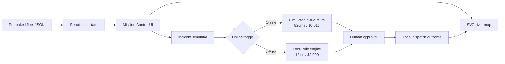

# RiverPilot AI

RiverPilot AI is a one-page Fleet Mission Control Screen for a hackathon demo. It uses pre-baked vessel data and local React state to demonstrate explainable triage in disconnected waters without requiring physical boat telemetry, an external backend, or API credentials.

## Run locally

```bash
npm install
npm run dev
```
## Live demo

[Open RiverPilot AI Mission Control](https://https://river-pilot-ai.vercel.app/)

Open [http://localhost:3000](http://localhost:3000).

## Six-hour demo flow

- Toggle **Online (Cloud)** and **Offline (Edge Cache)**. Offline mode immediately shows **Edge Mode Active**, a simulated 12ms latency, and zero token cost.
- Click **Run demo** to automatically switch to edge mode, inject the engine-overheat scenario, and approve the simulated Swali Ferry dispatch.
- Open **Simulate Incident** and choose **Engine Overheat · Boat 2** or **Low Keel Clearance · Boat 3**.
- Review the explainable triage card, then approve the Swali Ferry dispatch or dismiss it. The map and confirmation state update locally.
- All content comes from `data/fleet-simulation.json`; no real AIS, cloud inference, or captain commands are connected.

## Architecture



The demo is intentionally backend-free. The second incident and the **Run demo** sequence exercise the same local state transitions covered by `npm test`.

## Checks

```bash
npm run typecheck
npm test
npm run build
npm start
```
